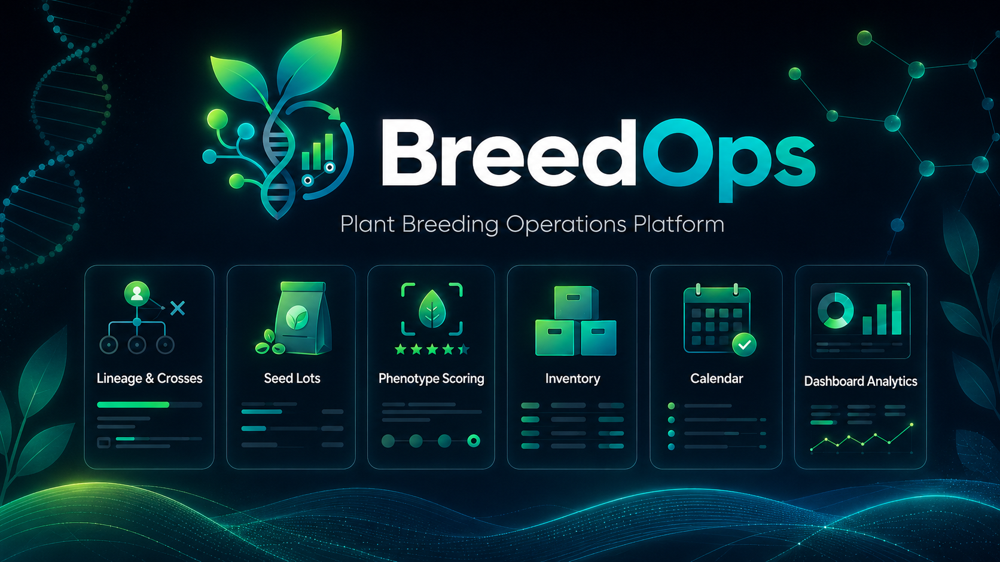
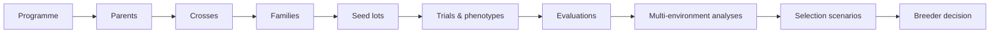

<p align="center">
  
</p>

<p align="center">
  
</p>

<h1 align="center">BreedOps</h1>

<p align="center">
  <strong>From breeding material to traceable selection decisions.</strong>
</p>

<p align="center">
  BreedOps is a self-hosted platform for managing plant-breeding operations,
  phenotyping, experimental workflows, inventory, field data collection and
  quantitative decision support.
</p>

---

## What BreedOps does

BreedOps links the biological and operational objects of a breeding programme
instead of treating them as isolated spreadsheets.



The application currently includes:

- breeding-material and pedigree management;
- seed-lot and germination tracking;
- configurable phenotyping and eliminatory criteria;
- private plant-media storage and scientific image annotations;
- inventory, stock movements and equipment tracking;
- experimental cycles, dependencies, calendar and Gantt;
- CSV/XLSX import and export;
- trait analytics;
- multi-environment analysis with mixed models, AMMI, GGE, WAASB/WAASBY and Finlay–Wilkinson;
- MGIDI and MTSI decision-support workflows;
- installable PWA field mode with offline phenotype capture and exact-once synchronization;
- role-based access, PostgreSQL Row-Level Security and auditable sensitive operations.

## Who it is for

BreedOps is designed for breeding and research teams that need a structured,
traceable workflow but do not want scientific decisions hidden behind opaque
automation.

The software assists the breeder; it does not replace scientific judgment.
Phenotypic ranking, stability metrics or selection indices are never presented
as genetic value unless the underlying design supports that interpretation.

## Start with the user guide

If you are not familiar with breeding software—or with plant breeding itself—
begin here:

1. [Getting started](docs/user-guide/01-getting-started.md)
2. [Understanding BreedOps](docs/user-guide/02-understanding-breedops.md)
3. [Create your first programme](docs/user-guide/03-create-your-first-program.md)
4. [Breeding material and crosses](docs/user-guide/04-genetic-material-and-crosses.md)
5. [Families and seed lots](docs/user-guide/05-families-and-seed-lots.md)
6. [Trials and phenotyping](docs/user-guide/06-trials-and-phenotyping.md)
7. [Offline field mode](docs/user-guide/07-field-mode-offline.md)
8. [Trait analytics](docs/user-guide/11-trait-analytics.md)
9. [Multi-environment analysis](docs/user-guide/12-multi-environment-analysis.md)
10. [Selection decisions](docs/user-guide/13-selection-decisions.md)

A glossary and short biological primers are available in [`docs/concepts/`](docs/concepts/).

## Scientific analytics

BreedOps uses a server-side R environment pinned with `renv`. Statistical
models are executed locally by the BreedOps server and include:

- mixed-model multi-environment analysis;
- AMMI;
- GGE;
- WAASB / WAASBY;
- Finlay–Wilkinson;
- MGIDI;
- MTSI.

Analyses are saved with reproducibility metadata. When the underlying data or
configuration changes, saved results can be marked stale instead of silently
presented as current.

## Offline field mode

The field workspace can be prepared while online, then used without network
connectivity for phenotype capture. Pending operations remain on the device
until synchronization succeeds. BreedOps protects against duplicate writes and
detects configuration changes between pack preparation and synchronization.

Remote PWA use requires HTTPS.

## Security and data

BreedOps uses:

- Supabase Auth;
- server-side authorization;
- PostgreSQL Row-Level Security;
- private object storage for scientific media;
- secure cookies and origin checks;
- login rate limiting;
- versioned database migrations;
- infrastructure and functional backup workflows.

Do not expose PostgreSQL or raw Supabase service ports directly to the Internet.

## Deployment

BreedOps is currently designed for self-hosted deployment with:

- Node.js / Next.js;
- local or self-hosted Supabase/PostgreSQL;
- R + `renv`;
- HTTPS for remote/PWA access.

See:

- [Deployment](docs/admin/deployment.md)
- [Remote access](docs/admin/remote-access.md)
- [Backup and restore](docs/admin/backup-restore.md)
- [Administration](docs/admin/administration.md)

## Validation

The repository includes unit, integration, RLS, R reference and Playwright
tests. Before deployment of a release snapshot:

```bash
npm ci
npm run release:check
```

A deployment should not be considered qualified if this command fails.

## Repository layout

```text
BreedOps/
├── analytics-r/      # R runtime, models and reference tests
├── assets/           # README branding
├── docs/             # user, biological, admin and technical documentation
├── e2e/              # browser-level validation
├── public/           # PWA icons/static assets
├── scripts/          # operational and validation scripts
├── src/              # Next.js application
├── supabase/         # database migrations/config/templates
└── tests/            # unit/integration/RLS tests
```

## License

See [`LICENSE`](LICENSE) and [`THIRD_PARTY_NOTICES.md`](THIRD_PARTY_NOTICES.md).

## Documentation map

Start with [`docs/index.md`](docs/index.md).
