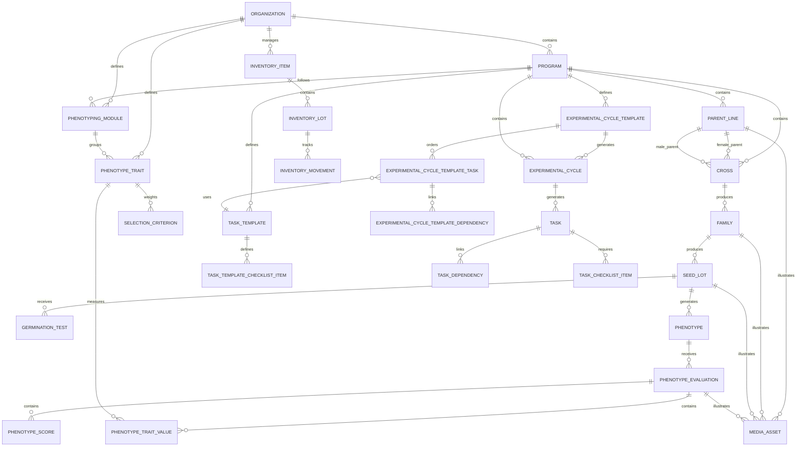

# Database Design

## Overview

BreedOps uses a PostgreSQL database with Supabase for authentication and storage. The database schema is designed to be normalized and follow the requirements in the project specification.

## Core Entities

### Organizations
Stores information about organizations using the platform.

### Profiles
Stores user profile information linked to Supabase auth users.

### Programs
Manages breeding programs within organizations.

### Team membership
Migration 000003 removes program_members. Each profile belongs to one organization/team;
program access inherits that team. V1 uses system_admin, team_admin and user.
Migration 000005 guards profile identity and privileged-role boundaries and restricts
trigger-only calculation functions. Migrations 000012–000013 implement pending-account
assignment and audited user administration. The final 25 auth/RLS assertions pass locally.

### Parent Lines
Stores information about parent lines used in crosses.

### Crosses
Records crossing events between parent lines.

### Families
Organizes crosses into families.

### Seed Lots
Tracks seed lots generated from families.

### Germination Tests
Records germination test results for seed lots.

### Phenotypes
Stores phenotypic information about individuals.

### Selection Models
Defines models for phenotypic evaluation.

### Selection Criteria
Defines criteria for selection models.

### Phenotype Evaluations
Records evaluations of phenotypes.

### Phenotype Scores
Stores individual scores for each selection criterion.

### Phenotype Traits
Team-scoped, reusable trait definitions (migration 000016): name, code, category, data
type (`numeric`, `integer`, `ordinal`, `categorical`, `boolean`, `date`, `text`), unit,
bounds/precision, allowed values for categorical traits, selection `direction`
(`higher_is_better`, `lower_is_better`, `target_value`, `neutral`) and protocol. Traits are
soft-archived (`is_active`), never deleted through the application, so historical
observations stay interpretable. `UNIQUE(organization_id, code)` prevents duplicate traits
within a team; `code` must be a stable, meaningful slug (e.g. `plant_height`), never a UUID.
A trait is reusable across every module and program of its own team; the application never
clones a trait to let one more program use it or to change its per-program weight — see
`program_phenotyping_modules` and `set_program_trait_weight` below.

Rows are only ever hard-deleted as part of deleting the whole owning `organizations` row
(the application has no "delete trait" action; traits are archived via `is_active`).
Migration 000017 fixes three foreign keys added in 000016
(`phenotyping_module_traits.trait_id`, `phenotype_trait_values.trait_id`,
`selection_criteria.trait_id`) that were missing `ON DELETE CASCADE`, unlike every sibling
column in that migration. Without it, deleting an organization that had ever run
`create_initial_selection_model` failed with a foreign key violation partway through —
which integration/E2E test teardown silently swallowed (see "Test fixture cleanup" below),
leaving the organization, its program, its "Sélection V1" module and six traits behind on
every run. A `system_admin` sees every team by design (`can_access_team()`, migration
000003), so these orphaned per-team copies showed up side by side in the trait/module
library and looked like unexplained duplicates, even though `UNIQUE(organization_id, code)`
/ `UNIQUE(organization_id, name)` held correctly within every individual team the whole
time. The trait and module library tables show an "Équipe" column (only when more than one
team is actually present in what the caller can see) so a legitimate cross-team view never
looks like an unexplained duplicate again.

### Test fixture cleanup
Integration tests and `e2e/critical-v1.spec.ts` each create a throwaway organization via
the service-role Supabase client and must remove it afterwards. `organizations` has RLS
enabled with only SELECT/INSERT/UPDATE policies (migration 000003) and no DELETE policy, by
design (soft delete only), so a PostgREST delete through the service-role client cannot be
relied on for teardown even when it returns no catchable error. `tests/db-cleanup.ts`
(`hardDeleteOrganization`) instead deletes the row directly against the database as the
Postgres superuser — the same privileged path `scripts/test-rls.mjs` already uses — which
now actually cascades, after the 000017 fix above. It also verifies the row actually
disappeared (`DELETE ... RETURNING id` and a check on the result) and throws if not, so a
cleanup that silently removes nothing fails the test loudly instead of leaking another
organization. Every suite that creates a synthetic organization
(`phenotypes.integration.test.ts`, `breeding.integration.test.ts`,
`inventory.integration.test.ts`, `operations.integration.test.ts`,
`auth.integration.test.ts`, `critical-v1.spec.ts`, `auth-management.spec.ts`) now tears it
down through this helper.

### Phenotyping Modules and Module Traits
A phenotyping module (`phenotyping_modules`) is a named, reusable, ordered group of traits
(`phenotyping_module_traits`, one row per trait with `display_order`). Modules compose the
evaluation form; they do not belong to a single program.

### Program Phenotyping Modules
`program_phenotyping_modules` selects which modules (and therefore which traits) a given
program follows, each independently activatable. `program_active_traits(program_id)`
resolves the program's current trait set (active modules → active traits, first module
wins on a conflict) and is the single source the evaluation form and `submit_trait_evaluation`
both read from.

### Phenotype Trait Values
One typed value per trait per evaluation (`phenotype_trait_values`): exactly one of
`numeric_value`, `text_value`, `boolean_value`, `date_value` is set, enforced by PostgreSQL.
Rows are written only by `submit_trait_evaluation` (SECURITY DEFINER; no direct insert
policy), which validates every value against the trait's bounds/precision/allowed values
before insert.

### Inventory Items
Tracks inventory items (reagents, consumables, equipment).

### Inventory Lots
Manages lots of inventory items.

### Inventory Movements
Records movements of inventory items.

### Experimental Workflows: Task Templates, Cycle Templates, Dependencies

Migration 000019 extends the original `task_templates` / `experimental_cycles` / `tasks` /
`task_checklist_items` model (000001, 000011) with reusable, dependency-aware workflow
templates. It never introduces a parallel project-management system: a cycle template is a
blueprint that *generates* ordinary `experimental_cycles` and `tasks` rows; execution always
happens on the real tables, exactly as before.

**Hierarchy**: Program → Experimental Cycle Template (optional) → Experimental Cycle →
Tasks → Task Checklist Items. A cycle can also be created manually, with no template at all
(`source_template_id IS NULL`); manual creation and manual task creation are unchanged and
fully preserved.

#### Task Templates
A reusable, program-scoped definition of one kind of operation (`task_templates`: code, name,
description, `zone`, `priority`, `sop_code`, `expected_deliverable`, `is_active`). Its
`relative_week`/`relative_day` columns are a **legacy hint** for manually assembled
workflows only; the generator never reads them. `task_templates_read` has no `deleted_at`
filter (relaxed the same way breeding entities were in 000014) so an "Afficher les archives"
view can list archived templates; archiving does not touch cycles already generated from it.

#### Task Template Checklist Items
`task_template_checklist_items` (label, `is_required`, `sort_order`) is the SOP/checklist
blueprint for a task template. It is copied into real `task_checklist_items` as a **snapshot**
at instantiation time; editing the template's checklist later never rewrites an
already-generated task's checklist.

#### Experimental Cycle Templates
`experimental_cycle_templates` (program-scoped: code, name, description, `is_active`,
`deleted_at`) is the reusable workflow blueprint itself — e.g. "Androgenèse — Brachypodium".
Archiving (`deleted_at`) blocks new instantiation but never affects cycles already generated.

#### Experimental Cycle Template Tasks
`experimental_cycle_template_tasks` is one ordered step of a template: a `task_template_id`
plus `start_offset_days` (minimum offset from the cycle's start date — dependencies can push a
step later, never earlier), `duration_days`, an optional `default_assigned_to`, and
`sort_order`. `move_cycle_template_task(template_id, step_id, step)` reorders a step by
swapping `sort_order` with its neighbour (the same pattern as `move_module_trait`, 000016).
Unlike historical-record tables, this is a composition/builder table and has a DELETE policy
(removing a step while editing a template is a normal, safe structural edit, matching the
`phenotyping_module_traits` precedent) — its `task_template_id` FK is `ON DELETE CASCADE` so
that deleting an organization/program still cascades cleanly all the way down.

#### Experimental Cycle Template Dependencies / Task Dependencies
`experimental_cycle_template_dependencies` (between two steps of the *same* template) and
`task_dependencies` (between two *real* tasks) both model **finish-to-start-only** edges —
MVP does not implement start-to-start/finish-to-finish/start-to-finish — with an integer
`lag_days >= 0`:

```
successor.planned_date >= predecessor.due_date + 1 + lag_days
```

Both tables reject, via a `BEFORE INSERT OR UPDATE` trigger (`validate_template_dependency` /
`validate_task_dependency`), anything that would break the model's invariants: self-reference
and exact duplicates (`CHECK`/`UNIQUE`), an edge between two different templates, between two
different programs, between two different experimental cycles, to an archived/deleted or
cancelled task, and — using a recursive CTE that computes every template-task/task reachable
**forward** from the successor and checks whether the predecessor is already in that set —
any edge that would close a cycle in the dependency graph. Both tables are composition data
(not historical scientific records) and so, like `experimental_cycle_template_tasks`, carry a
DELETE policy.

#### Scheduling: `compute_cycle_template_schedule`, `instantiate_experimental_cycle`, `recalculate_cycle_schedule`

`compute_cycle_template_schedule(template_id, start_date)` is the **single** SQL function
behind both the read-only schedule preview and real instantiation, so the two can never
diverge. It walks the template's dependency graph in **topological order** (Kahn's algorithm,
via a `pg_temp` working table — never template `sort_order`) and for each step computes:

```
base_start       = cycle_start + start_offset_days
dependency_start = MAX(predecessor.due_date + 1 + lag_days) over all its predecessors
planned_date     = GREATEST(base_start, dependency_start)
due_date         = planned_date + duration_days - 1
```

`instantiate_experimental_cycle(template_id, cycle_name, start_date)` is a single
transactional function: it creates the `experimental_cycles` row (`source_template_id` set),
one `tasks` row per step with its template fields **copied at this moment only** (title,
description, priority, zone, sop_code, expected_deliverable — a snapshot, exactly like
Task Template Checklist Items above), the matching `task_dependencies` edges, and each task's
checklist snapshot, then sets the cycle's `end_date` to the latest generated task's `due_date`.
Either everything is created or nothing is (a plain Postgres transaction) — an unknown,
archived or inaccessible template raises before any row is written.

`recalculate_cycle_schedule(task_id, new_planned_date, new_due_date)` is "Enregistrer et
recalculer les dépendances": it applies the new dates to one task, then walks the *same*
cycle's dependency graph in topological order, moving only the downstream tasks whose computed
`dependency_start` now exceeds their current `planned_date`, while preserving each moved
task's own `duration_days`. A task's own schedule is checked against its *own* predecessors
first. It raises (rolling back the whole call, so nothing is partially applied) if the new
dates would leave it violating its own predecessors, or if propagation would require moving a
task whose `status = 'completed'` — actual completion time is operational history and is never
silently rewritten; the caller must resolve the conflict by hand. Completing a task later or
earlier than planned never itself reshuffles the plan: propagation only happens from this
explicit, user-initiated date change.

Dependency **readiness** (ready / waiting-on-a-dependency / completed / cancelled) is derived
in the application from task status and predecessor statuses, not persisted, and is distinct
from the manual `blocked` task status — a task can be `not_started` while structurally waiting
on a predecessor.

#### `plan_filter` and whole-table `UPDATE`s
This project's Postgres loads the `plan_filter` extension, which rejects any `UPDATE` without
a `WHERE` clause for a non-superuser role — including PostgREST's `authenticated` role, which
is what every RPC above actually executes as. The topological-sort helpers intentionally
recompute an `indegree` column for **every** row of their `pg_temp` working table; that
`UPDATE` carries a harmless `WHERE true` specifically so it still passes under `plan_filter`
when called through the API (a superuser `psql` session does not hit this, which is why it is
easy to miss when first testing a function directly).

### Experimental Cycles
Organizes tasks into experimental cycles. `source_template_id` (nullable, `ON DELETE SET
NULL`) records which cycle template a cycle was generated from, for traceability only —
editing or archiving the template never changes cycles already generated from it. A cycle
created manually (the original, still-supported flow) leaves it `NULL` and keeps supplying
`start_date`/`end_date` directly.

### Tasks
Records specific tasks within experimental cycles, generated from a template or created
manually. `task_template_id` is kept for traceability; `set_task_status()` (000011) is the
only sanctioned path for status changes and was extended (never replaced) in 000019 to reject
`completed` while the task has any incomplete *required* checklist item, with the exact
user-facing message `"Cette tâche comporte encore des contrôles obligatoires non terminés."`
(optional items never block completion). A task's duration is derived from
`due_date - planned_date + 1`, never a separately persisted column.

### Task Checklist Items
Tracks checklist items for tasks; `sort_order` (added in 000019) keeps template-generated and
manually added items in a stable order. `complete_checklist_item(item_id, completed, comment)`
is the only sanctioned way to toggle one: `completed_by`/`completed_at` are always derived
server-side from `auth.uid()`, never trusted from the client.

### Audit Logs
Records all significant actions for audit purposes.

### Media Assets (Plant Media)
`media_assets` (migration 000018) holds metadata for real plant/scientific images attached
to a breeding record; the binary itself lives in the private Supabase Storage bucket
`breedops-media` (`public = false`, 10 MiB limit, `image/jpeg`/`image/png`/`image/webp`
only), created by the migration itself (`INSERT INTO storage.buckets ...`) so it exists
identically on every environment that applies it, local or hosted — never created by hand
in Studio. A signed URL is generated on demand (TTL 300s) and never persisted; no public or
signed URL is ever stored in PostgreSQL.

Supported targets are exactly `parent_line_id`, `family_id`, `seed_lot_id` and
`phenotype_evaluation_id` (crosses are intentionally out of scope). A `CHECK` using
`num_nonnulls()` enforces exactly one target per row. `organization_id`/`program_id` are
never trusted from the client: a `BEFORE INSERT` `SECURITY DEFINER` trigger
(`validate_media_asset_target`) resolves them from the target entity itself and overwrites
whatever the client sent, so a forged or mistaken value cannot attach media to another
team's record. `guard_media_asset_identity` then makes the target and storage identity
immutable after creation (only presentation metadata, primary status and archive state may
change); `created_by` is deliberately excluded from that guard because it is
`ON DELETE SET NULL` against `profiles` — including it there made deleting the author's
profile fail with "immutable" instead of nulling the reference.

At most one *active* (non-archived) image per target may be `is_primary`, enforced by four
partial unique indexes (`WHERE is_primary AND archived_at IS NULL`). `set_media_primary(id)`
(SECURITY INVOKER) does the unset-then-set two-step atomically so it never transiently
violates the index. A `BEFORE INSERT OR UPDATE` trigger clears `is_primary` whenever a row
is archived, so an archived primary image is never left flagged primary and a later restore
never silently re-promotes it — "no primary" is an allowed, temporary state.

Media is archived (`archived_at`/`archived_by`), never hard-deleted: there is no DELETE
policy, matching every other breeding lifecycle table. Archiving the owning breeding entity
does not touch its media; historical images remain fully readable. The authorization model
reuses the existing `can_access_team`/`can_write_team` RLS helpers on `media_assets` itself
— no new role, no separate Storage RLS policy. Storage object operations (upload, signed
URL, delete) always go through the service-role admin client, and only after the metadata
layer's RLS check has already passed; the browser never receives the service-role key.
Storage and Postgres are not transactional with each other: if the metadata insert fails
after a successful upload, the server compensates by deleting the just-uploaded object
(`removeMediaObject`), so no orphan is left behind. `scripts/check-media-orphans.mjs` is a
read-only maintenance check that diffs the bucket's objects against
`media_assets.storage_path` and reports (without deleting) any orphan object or dangling
row.

## Relationships



## Data Types and Constraints

All tables follow the naming conventions:
- `id` (UUID)
- `created_at` (timestamp)
- `updated_at` (timestamp)
- `created_by` (UUID)
- `updated_by` (UUID)
- `deleted_at` (timestamp for soft deletes)
- `organization_id` (UUID)
- `program_id` (UUID, when relevant)

## Security and RLS

Row-Level Security (RLS) policies are implemented on all tables to ensure proper data isolation:
- Users can only access data within their organization
- Program access inherits the authenticated profile's team
- Pending Auth identities have no profile, tenant membership or business-data access
- User invitation, creation, activation, role/team changes and administrator password resets are audited
- `phenotype_trait_values` has no client insert policy: it is written only by the
  `submit_trait_evaluation` SECURITY DEFINER function, which re-checks `can_write_program`
  and every trait's constraints before writing
- `media_assets` reuses `can_access_team`/`can_write_team` directly for SELECT/INSERT/UPDATE;
  `organization_id`/`program_id` are derived server-side from the target entity (never
  trusted from the client) and the row's target/storage identity is immutable after
  creation; there is no DELETE policy (archive only)
- Every experimental-workflow table (`experimental_cycle_templates` and its steps/
  dependencies, `task_dependencies`, `task_template_checklist_items`) reuses
  `can_access_program`/`can_write_program` exactly as `task_templates`/`tasks` already did —
  no new role, no new RLS helper. A dependency or a template step can never bridge two
  programs or two organizations: the integrity triggers check this directly, and RLS alone
  would not be enough since both rows could otherwise belong to programs the same
  `team_admin` can write. `task_templates_read` and `experimental_cycle_templates_read` have
  no `deleted_at` filter (so archived definitions remain listable); every other
  experimental-workflow table still filters `deleted_at`/hides archived rows exactly as
  before.

## Calculations and Functions

### Germination Rate Calculation
```sql
germination_rate = (seeds_germinated / seeds_tested) * 100
```

### Seed Yield Calculation
```sql
seed_yield_per_pollinated_unit = total_seeds / pollinated_units
```

### Score Calculations
- Weighted score: sum of weighted criterion scores
- Normalized score: weighted score / maximum score * 100
- Automatic decision: based on score and stability thresholds

### Stock Calculations
```sql
current_quantity = initial_quantity + total_positive_movements - total_negative_movements
days_before_expiration = expiration_date - current_date
```

### Delay Calculation
```sql
delay_days = max(0, current_date - due_date)
```

## Indexes

All tables have appropriate indexes for performance:
- Foreign key indexes
- Frequently queried columns
- Composite indexes for complex queries
- Audit log indexes for performance

## Migration Strategy

Database migrations are versioned and sequential:
- One migration file per logical change
- Migrations are never edited after being applied
- All migrations are tested on a clean database
- Functions and policies are part of the migration files
