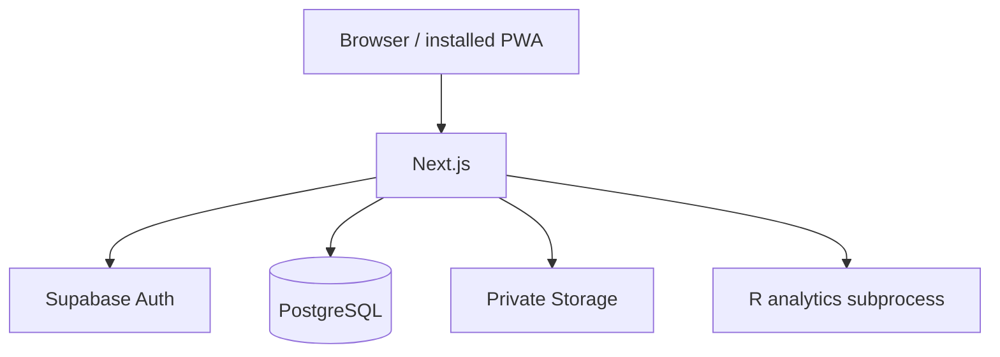

# Architecture

BreedOps uses a Next.js application backed by Supabase/PostgreSQL.

Critical scientific/database operations are validated server-side. PostgreSQL
RLS isolates organization-owned data. Statistical models execute in a pinned
`renv` environment.

The offline field subsystem uses local IndexedDB plus a server-side exact-once
synchronization protocol.
